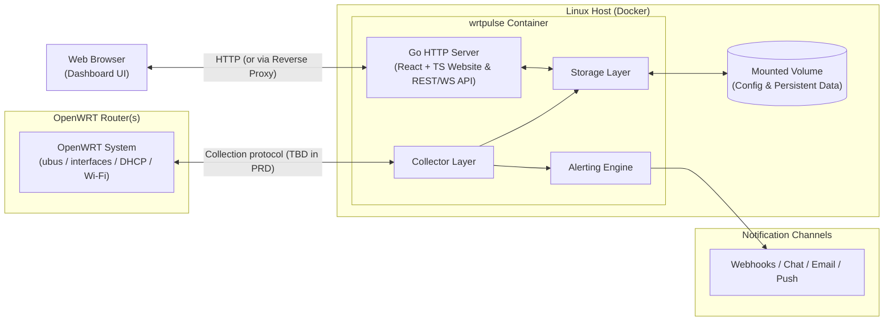

# wrtpulse Architecture Plan

> **Living Document:** This document captures the initial high-level architecture for `wrtpulse`. Specific protocols, schemas, and feature scopes will be defined and refined in individual [PRDs](prd/README.md) before implementation.

## Deployment Target

`wrtpulse` is a self-hosted **web application** designed to run inside a **single Docker container on Linux** (via Docker / Docker Compose). Users access the monitoring dashboard and alerting controls through a browser, while the container monitors one or more OpenWRT routers over the LAN/network and persists state to a mounted Linux host volume.

## Design Principles

1. **Docker-First Linux Web App:** Ship as a single container built via a multi-stage `Dockerfile` (Linux target, `amd64`/`arm64`), serving the React/TypeScript website and backend API over HTTP with a mounted volume for persistent data and config.
2. **Lightweight & Self-Contained:** The Go backend serves the compiled frontend assets directly alongside the API, collector, storage, and alerting engine—no external database or multi-service stack required out of the box.
3. **Router-Friendly (Runs Off-Router):** Because `wrtpulse` runs on a Linux Docker host rather than on the router itself, CPU, RAM, and flash overhead on OpenWRT stays minimal.
4. **PRD-Driven Iteration:** Build incrementally around clear, scoped PRDs rather than locking in premature abstractions.

## High-Level System Overview

## Planned Module Layout

| Path | Responsibility |
| --- | --- |
| `cmd/wrtpulse/` | Go server entrypoint, config/env flags, graceful container shutdown (`SIGTERM`) |
| `internal/config/` | Configuration loading (mounted config file + environment variables) |
| `internal/collector/` | OpenWRT data collection adapters and polling/ingestion loop |
| `internal/store/` | Persistent metrics and state storage backed by the mounted Docker volume |
| `internal/alert/` | Rule evaluation, deduplication/cooldowns, and notification dispatchers |
| `internal/api/` | REST/WebSocket endpoints and static serving for the React/TS website |
| `web/` | React + TypeScript web dashboard |
| `deploy/` | Multi-stage `Dockerfile`, `docker-compose.yml`, and Linux deployment docs/examples |

## Key Decisions Deferred to PRDs

The following areas are intentionally left open until dedicated PRDs are written:

1. **OpenWRT Collection Protocol:** Agentless polling from the Docker container (e.g., `ubus` JSON-RPC over HTTP/HTTPS, SSH, SNMP) vs. an optional lightweight exporter on OpenWRT vs. hybrid.
2. **Data Model & Retention:** Embedded SQLite vs. other embedded time-series storage inside the mounted volume, downsampling, and retention windows.
3. **Core Metrics & Dashboard UX:** Interface bandwidth, WAN health/latency, DHCP/connected clients, wireless stations, router CPU/memory/temperature, and real-time refresh (WebSockets/SSE vs. polling).
4. **Alerting Model:** Threshold rules, state-change events (e.g., WAN down, new device joined), flapping/cooldown handling, and initial notification integrations.
5. **Authentication, Networking & Multi-Router Support:** Dashboard login, reverse-proxy compatibility (Caddy/Traefik/Nginx), Docker networking mode (bridge vs. host if needed for LAN discovery), and secret management for router credentials.
