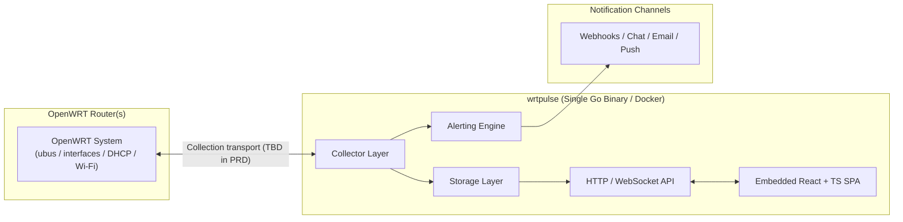

# wrtpulse Architecture Plan

> **Living Document:** This document captures the initial high-level architecture for `wrtpulse`. Specific protocols, schemas, and feature scopes will be defined and refined in individual [PRDs](prd/README.md) before implementation.

## Design Principles

1. **Lightweight & Self-Contained:** Package the Go backend and compiled React/TypeScript frontend into a single binary with minimal runtime dependencies and low memory overhead.
2. **Router-Friendly:** Keep CPU, RAM, and flash overhead on OpenWRT routers minimal.
3. **Docker-Ready:** Provide a clean container image and Compose setup for homelab or server deployments.
4. **PRD-Driven Iteration:** Build incrementally around clear, scoped PRDs rather than locking in premature abstractions.

## High-Level System Overview

## Planned Module Layout

| Path | Responsibility |
| --- | --- |
| `cmd/wrtpulse/` | Main CLI / server entrypoint, flags, signal handling |
| `internal/config/` | Configuration loading and validation |
| `internal/collector/` | OpenWRT data collection adapters and polling/ingestion loop |
| `internal/store/` | Time-series and state persistence (e.g., embedded SQLite) |
| `internal/alert/` | Rule evaluation, deduplication/cooldowns, and notification dispatchers |
| `internal/api/` | REST/WebSocket endpoints and static asset serving for the SPA |
| `web/` | React + TypeScript dashboard UI |
| `deploy/` | `Dockerfile`, `docker-compose.yml`, and optional OpenWRT helper scripts |

## Key Decisions Deferred to PRDs

The following areas are intentionally left open until dedicated PRDs are written:

1. **Deployment & Collection Mode:** Polling OpenWRT externally (e.g., `ubus` JSON-RPC over HTTP/HTTPS, SSH, SNMP) vs. a lightweight push agent/exporter on the router vs. hybrid.
2. **Data Model & Retention:** Embedded SQLite vs. other lightweight time-series storage, downsampling, and retention windows.
3. **Core Metrics Scope:** Interface traffic, WAN health/latency, DHCP/connected clients, wireless stations, router CPU/memory/temperature.
4. **Alerting Model:** Threshold rules, state-change events (e.g., WAN down, new device joined), flapping/cooldown handling, and initial notification integrations.
5. **Authentication & Multi-Router Support:** Single-router vs. multi-router inventory, dashboard authentication, and secret management for router credentials.
